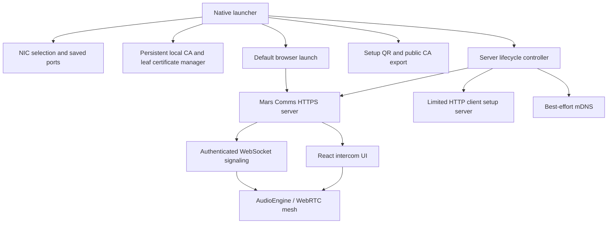

# Mars Comms architecture

Electron 44 provides a small native launcher and bundled Node runtime. Its main process runs the existing Express/SQLite/WebSocket backend directly; no external Node installation or terminal process is needed. The launcher renderer is a packaged local page with no browser chrome. The intercom React UI remains a separate, normal browser application. All runtime assets are local.

## Native process and IPC boundary

Portable launches use a unique extraction directory per invocation. Repeated launches restore/focus the original window, recreating it if missing. Window lifecycle handlers are attached before loading UI content. After graceful controller disposal, the launcher explicitly exits the Electron process so the portable wrapper also terminates. A bounded eight-second shutdown deadline prevents indefinite invisible instances. Startup, window and shutdown diagnostics go to the per-user `logs/launcher.log`; no certificate/key contents or passwords are logged.

`desktop/main.ts` owns a single-instance Electron application, native window, OS save/open dialogs and default-browser launch. It loads only the packaged launcher file, denies navigation/new windows and renderer permissions, and validates every IPC sender against its own main frame and exact file URL. `desktop/preload.ts` exposes a narrow typed operation per action with context isolation enabled, Node integration disabled and Chromium sandbox enabled. The renderer cannot choose arbitrary file paths, execute commands, request arbitrary URLs or access filesystem/Node primitives. Export/import paths come from native dialogs in main. No private key contents are sent through IPC.

There is no browser launcher page, localhost launcher control API or port-8091 configuration service. `LauncherController` is the single implementation used by Electron and service tests. It owns Stopped/Starting/Running/Stopping/Error transitions, rejects overlapping starts/configuration, rolls partial startup back if either listener fails, gracefully closes WebSockets, sends mDNS goodbye, closes HTTP/HTTPS connections and SQLite, and clears in-memory talk state. Closing the native window stops the controller and quits on all OSes. There is intentionally no tray process or auto-start.

## Network and saved settings

`launcher/network.ts` enumerates usable IPv4 interfaces, filters loopback/link-local/obvious virtual/VPN adapters, deduplicates addresses and adds explicit localhost development mode. Settings store both interface name and IP plus HTTPS and bootstrap ports. A disappeared NIC or IP requires deliberate reselection; binding never silently moves to another address. Defaults are HTTPS 8090 and HTTP setup 8092. Bonjour uses the existing library and advertises only the actual bound IPv4; discovery failure never prevents the IP server from running.

## Local CA and certificate lifecycle

`CertificateManager` uses the established selfsigned library and Node/WebCrypto X.509 implementation. Root CA: RSA 3072, SHA-256, CA constraints/path length zero, signing key usages, approximately 10 years. Leaf: RSA 2048, SHA-256, CA=false, TLS server authentication EKU, digital-signature/key-encipherment usages, at most 397 days and never beyond CA validity. Every leaf has SANs for MarsComms.local, localhost, 127.0.0.1 and the selected LAN IPv4.

Status validates key/certificate matches, CA constraints/signature, issuer signature, validity dates and all required SANs. Missing, ready, needs-update, expired and error are distinct. A 30-day renewal window shows needs-update. Changing IP or renewing a leaf reuses the exact CA certificate/key. Damaged/incomplete/expired root CAs are not automatically replaced; this avoids silently invalidating every crew device's trust. User-facing errors describe recovery rather than OpenSSL codes.

CA creation writes a new private directory then renames it into place. Each leaf generation gets a new directory; an atomically replaced active.json selects the complete pair, so interrupted renewal does not select half-written files. Old leaf directories are retained for recovery. Private files request POSIX 0600 and directories 0700; Windows relies on inherited per-user profile ACLs. Key files are local to the operator account, not a hardened HSM/keychain; secure backups and account permissions matter.

The only export operation reconstructs a canonical public X.509 certificate. Its source path is fixed, it refuses destinations inside the private certificate directory, and it never copies a supplied arbitrary file. The root private key and server keys are neither IPC response data nor web resources. OS trust installation is manual and explicit; no code modifies trust stores.

## HTTP bootstrap and client trust

The actual intercom always starts with TLS under the native controller. The separate HTTP server allows GET/HEAD only at `/setup`, `/certificate` and a root redirect; all other routes are 404, mutations 405, WebSocket upgrades are destroyed. It has no static-file middleware, sessions, login, users or admin APIs. The HTTPS server exposes the same public setup routes, then the original authenticated application. Its static root is explicitly the packaged dist directory and unknown routes return 404, preventing certificate/data path traversal from becoming a file server.

The bootstrap page provides the public .crt, HTTPS IP URL and concise platform trust instructions. The QR contains only the selected HTTP IP setup URL. Root trust solves the initial HTTPS bootstrapping problem, but plain HTTP cannot authenticate the certificate download. Operators must compare the actual downloaded certificate's SHA-256 fingerprint through a trusted channel or distribute the exported CA by trusted direct transfer. Comparing attacker-controlled text on the HTTP page alone is insufficient. The launcher and setup page state this tradeoff. LAN trust does not eliminate a network attacker's ability to replace HTTP content.

## Storage and migration

Packaged paths are `%APPDATA%/Mars Comms` on Windows, `~/Library/Application Support/Mars Comms` on macOS, and `$XDG_DATA_HOME/Mars Comms` (fallback `~/.local/share/Mars Comms`) on Linux. Development retains the existing repository data directory. `launcher/paths.ts` is tested separately; packaged resource paths use app.getAppPath rather than the process working directory.

Layout: `mars.sqlite`, `launcher.json`, `certificates/ca/mars-comms-root-ca.pem`, private `mars-comms-root-ca-key.pem`, `certificates/server/<generation>/mars-comms-server.pem` and private server key, plus `certificates/active.json`. These directories are outside packaged resources and Git. The test-only MARS_COMMS_TEST_DATA_DIR override isolates automated runs.

The native import dialog is optional, explicit and only works before a target database exists. It verifies the legacy schema/integrity and uses SQLite backup, including committed WAL contents, without modifying the source. Existing target databases are never overwritten. Packaged first run otherwise seeds the original admin/groups. Development's existing database remains in place; only launcher configuration is upgraded when settings are saved. Old manually selected certificates are not imported as the integrated CA. Back up the entire stopped application-data folder to retain CA identity.

## Packaging

esbuild bundles launcher/controller/server code to CommonJS for Electron main, bundles a sandbox-compatible preload and a browser-only renderer. Vite builds the unchanged intercom assets. electron-builder packages these, production dependencies and Electron into an ASAR-based application; private data/source checkout files are excluded. Windows x64 NSIS and portable EXE targets are implemented, with macOS DMG/app and Linux AppImage configuration. Executable resources use the generated Mars icon; builds are unsigned and do not publish automatically. No native SQLite module rebuild is required because the runtime uses node:sqlite.

## Authentication and storage

Node's built-in SQLite persists users, salted scrypt hashes, groups, assignments, digital microphone gain and 12-hour server-side sessions. Session cookies are HttpOnly, SameSite=Strict and Secure under HTTPS. Every admin API checks the current database user. Mutations reject foreign Origin headers; authenticated WebSocket upgrades also validate Origin. Login attempts are limited per IP. At least one enabled administrator must remain. Passwords are never returned by APIs. These mechanisms are preserved from the original intercom implementation.

## Signaling and runtime state

`shared/types.ts` defines the wire protocol; Zod validates inbound messages. Each browser connection has its own random peer ID; this also permits multiple devices logged into the same account. The server validates every submitted talk/listen group against current membership and enabled groups. It relays signaling only between peers sharing membership. Clients see only relevant presence and shared group information. PTT, latch and talk state live in memory and are never persisted.

`server/signaling.ts` owns the sole peer registry, including presence, talk, listen and signaling lookup. Its idempotent `removePeer` deletes the peer and clears its talk/listen arrays before closing/terminating the transport. Close, socket error, invalid message/session, heartbeat expiry, closing-socket reconciliation and server shutdown all use this operation. Removal publishes a corrected snapshot immediately, or within the same synchronous reconciliation pass when batching. Late messages/pongs/close callbacks cannot restore a removed entry. No persisted user settings or other peer for the same user/session are removed.

WebSocket ping/pong runs every second. The client's existing two-second watchdog also sends an application heartbeat: a transport pong alone cannot prove that page JavaScript is still running. Each registry entry records monotonic last-pong and last-valid-application-message times (initially connection establishment). Both must remain within a five-second deadline. The same reconciliation removes a peer if either expires, tolerating multiple missed checks without a separate cleanup system. A silent network loss or frozen page is detected within approximately five to six seconds of its last qualifying response under normal event-loop scheduling, without waiting for TCP or a close handshake. This is not instantaneous physical network-loss detection; a stalled/suspended server delays its own timers. Session expiry, disabled/deleted users and invalid membership/group state are rechecked before snapshots, at least once per second. Admin mutations/logout already trigger immediate reconciliation. Membership/group changes retain the connected peer but strip all now-unauthorized talk/listen groups before broadcasting. Clients must reload after this protocol update to acquire the application heartbeat.

The client resets all transmission on disconnect, page hiding, window blur and page exit. Reconnection uses the session cookie, a fresh peer ID and empty talk state. Listen preferences are stored per user in localStorage. Lost pointer capture, pointer cancellation and keyboard release clear momentary PTT. Latch and held groups are combined as a set, so releasing PTT does not cancel an existing latch.

## Audio and topology

`AudioEngine` owns one microphone capture pipeline, Web Audio digital microphone gain, per-recipient transmission gates, output elements and device selection. `Communications` owns WebSockets, peer lifecycle, SDP negotiation, ICE and reconnects. React only requests operations on these abstractions.

Each relevant browser pair has one RTCPeerConnection with audio only, no STUN/TURN servers. A per-peer Web Audio GainNode opens only when local talk groups intersect the recipient's enabled listen groups. Otherwise the outgoing stream contains silence. This retains negotiated tracks for responsive PTT and avoids repeated capture or renegotiation. Silent RTP/keepalive traffic can still occur. Incoming playback uses the **maximum** volume among overlapping active listening groups; identical microphone audio is played once, avoiding duplicate summing. Listen off and volume zero also remove receive intent from signaling. Capture continues while enabled; audio is gated rather than releasing the hardware on every PTT.

Perfect negotiation uses a deterministic polite peer, implicit rollback, ICE candidate queues and failed-connection ICE restarts. Audio device changes replace the microphone source without changing negotiated tracks. Speaker selection uses feature-detected setSinkId; unsupported devices use system routing. Explicit Enable Microphone is currently required to join media, including listening.

## Trust boundary and limitations

Server authorization protects management, memberships, presence and signaling. The mesh is a trusted-crew MVP: browsers enforce media gates and playback; a modified/malicious client can bypass its own local gates. It is not a server-enforced confidential media isolation system. Use an SFU with server-authorized per-group subscriptions for hostile clients or strict separation. Application digital gain similarly cannot control malicious client software or hardware gain.

LAN HTTPS must use a certificate trusted on each client. mDNS is discovery, not certificate trust. No automatic certificate-warning bypass is used.

## Future SFU migration

Keep group state, session authorization and administration APIs. Replace Communications peer links and AudioEngine recipient gates with an SFU transport adapter; enforce publisher/subscriber group permissions on the SFU. React group controls need no low-level media changes. IFB, priorities, recording and external integration are deliberately outside this MVP.
